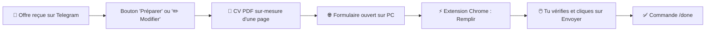

# ApplyPilot (ApplyBot) 🇫🇷

> **L'assistant intelligent et transparent de recherche de stage, d'alternance et de job étudiant.**  
> Veille automatique sur **HelloWork** et **Indeed**, génération de **CV sur-mesure d'une seule page (LaTeX / PDF)**, préremplissage automatique des formulaires via extension Chrome, et pilotage complet depuis **Telegram**.

---

### 🛡️ Le principe fondamental : 100 % tes données, 0 % d'invention

* **Zéro invention** : Le moteur de CV ne prend ses faits que dans **un seul fichier : le tien** (`~/.applypilot/experiences.json`). Le modèle de langage (LLM) sélectionne et ordonne tes expériences les plus adaptées à chaque offre, mais **recopie tes puces de réalisations mot pour mot**. Si une compétence n'est pas dans ton catalogue, elle n'apparaîtra sur aucun CV.
* **Zéro fuite d'informations** : Le code est totalement découplé de l'auteur d'origine. Avec tes propres fichiers de configuration, **seules tes données** (nom, école, ville, projets, liens) apparaissent sur tes CV et formulaires.
* **Tu gardes toujours la main** : L'extension préremplit le formulaire et attache ton CV sur-mesure, mais **ne clique jamais sur « Envoyer »**. C'est toi qui relis et valides chaque candidature.

---

## Sommaire

1. [Ce qu'il te faut (Prérequis)](#1-ce-quil-te-faut-prérequis)
2. [Installation en 5 minutes](#2-installation-en-5-minutes)
3. [Configuration de TON profil (Tes infos à toi)](#3-configuration-de-ton-profil-tes-infos-à-toi)
   - [3.1 Tes clés d'API (`.env`)](#31-tes-clés-dapi-env)
   - [3.2 Ton catalogue d'expériences (`experiences.json`)](#32-ton-catalogue-dexpériences-experiencesjson)
   - [3.3 Ton profil de formulaires (`profile.json`)](#33-ton-profil-de-formulaires-profilejson)
   - [3.4 Tes mots-clés de veille (`searches.yaml`)](#34-tes-mots-clés-de-veille-searchesyaml)
   - [3.5 Ton CV pour les jobs étudiants (`cv_job_etudiant.json`) *(facultatif)*](#35-ton-cv-pour-les-jobs-étudiants-cv_job_etudiantjson-facultatif)
   - [3.6 Ta photo d'identité *(facultatif)*](#36-ta-photo-didentité-facultatif)
4. [Génération & Réserve de CV sur-mesure](#4-génération--réserve-de-cv-sur-mesure)
5. [Le Bot Telegram au quotidien](#5-le-bot-telegram-au-quotidien)
6. [L'Extension Chrome d'auto-remplissage](#6-lextension-chrome-dauto-remplissage)
7. [Suivi des consultations de ton CV *(facultatif)*](#7-suivi-des-consultations-de-ton-cv-facultatif)
8. [Personnaliser les branches à ton métier](#8-personnaliser-les-branches-à-ton-métier)
9. [Dépannage & FAQ](#9-dépannage--faq)

---

## 1. Ce qu'il te faut (Prérequis)

| Outil | Rôle | Gratuit ? | Obligatoire |
|---|---|---|---|
| **Python 3.11+** | Moteur d'ApplyPilot | Oui | **Oui** |
| **MiKTeX** (Windows) ou **TeX Live** (Linux/Mac) | Fournit `pdflatex` pour compiler les CV en PDF haute qualité | Oui | **Oui** |
| **Clé API LLM (Groq)** | Analyse les offres et oriente les CV (Llama 3.3 70B ultra-rapide) | Oui (sans CB) | **Oui** |
| **Bot Telegram** | Piloter l'outil, recevoir les offres et CV sur ton téléphone | Oui | Recommandé |
| **Google Chrome** | Utiliser l'extension de préremplissage automatique | Oui | Facultatif |

> [!NOTE]
> Le projet est optimisé et testé sous **Windows 11 avec PowerShell**, mais fonctionne également sous Linux et macOS.

---

## 2. Installation en 5 minutes

Ouvre un terminal **PowerShell** dans ton dossier de travail :

```powershell
# 1. Cloner le dépôt
git clone https://github.com/JamaiAli/applybot.git
cd applybot

# 2. Créer et activer l'environnement virtuel Python
python -m venv .venv
.\.venv\Scripts\python.exe -m pip install -e ".[dev]"
.\.venv\Scripts\python.exe -m pip install pymupdf
```

Vérifie que Python et LaTeX fonctionnent correctement :

```powershell
.\.venv\Scripts\applypilot.exe --help
pdflatex --version
```

> [!TIP]
> Si `pdflatex` n'est pas reconnu sous Windows, télécharge et installe [MiKTeX](https://miktex.org/download), puis ferme et rouvre ton terminal. Lors de la toute première compilation d'un CV, MiKTeX téléchargera automatiquement les extensions de mise en page nécessaires (compte 1 à 2 minutes).

Toutes tes données personnelles vivent **hors du dépôt Git**, dans ton dossier utilisateur `~/.applypilot/` (`C:\Users\<ton-nom>\.applypilot\`). Crée ce dossier :

```powershell
New-Item -ItemType Directory -Force "$HOME\.applypilot\cv_latex\assets"
```

---

## 3. Configuration de TON profil (Tes infos à toi)

C'est l'étape essentielle : **la qualité de tes CV et la précision du préremplissage dépendent uniquement de ce que tu écris ici.** Aucun contenu par défaut ne viendra polluer tes candidatures.

Des fichiers d'exemples propres (`*.example.json` / `*.example.yaml`) sont fournis dans le dépôt pour te servir de modèle.

### 3.1 Tes clés d'API (`.env`)

Copie le modèle de configuration :

```powershell
Copy-Item .env.example "$HOME\.applypilot\.env"
```

Ouvre le fichier `$HOME\.applypilot\.env` avec un éditeur de texte (Bloc-notes, VS Code...) et renseigne tes informations :

```ini
# --- Fournisseur LLM principal (Groq : gratuit et très rapide) ---
GROQ_API_KEY=gsk_ton_token_ici

# --- Fournisseur LLM de secours (facultatif) ---
GEMINI_API_KEY=AIzaSy_ton_token_ici

# --- Bot Telegram ---
TELEGRAM_BOT_TOKEN=123456789:ABCdefGHIjklMNOpqrSTUvwxYZ
TELEGRAM_USER_ID=987654321
```

* **`GROQ_API_KEY`** : Obtiens ta clé gratuite en 30 secondes sur [console.groq.com/keys](https://console.groq.com/keys) (aucune carte bancaire requise).
* **`TELEGRAM_BOT_TOKEN`** : Sur Telegram, parle à [@BotFather](https://t.me/BotFather), envoie `/newbot` et copie le jeton fourni.
* **`TELEGRAM_USER_ID`** : Sur Telegram, parle à [@userinfobot](https://t.me/userinfobot) pour connaître ton identifiant numérique. **Le bot n'obéira qu'à cet identifiant pour protéger tes données.**

---

### 3.2 Ton catalogue d'expériences (`experiences.json`)

C'est la **base de données unique de ton profil**. Le moteur de CV y sélectionne les projets pertinents pour chaque offre.

Copie le modèle d'exemple :

```powershell
Copy-Item experiences.example.json "$HOME\.applypilot\experiences.json"
```

Ouvre `$HOME\.applypilot\experiences.json` et remplace les exemples par tes vraies informations :

#### A. Le bloc `candidate` (Coordonnées)
```json
"candidate": {
  "full_name": "Alex Dupont",
  "title": "Élève-ingénieur en Informatique & Logiciel",
  "objective": "Recherche un stage de fin d'études de 6 mois à partir de mars 2027 en ingénierie logicielle.",
  "location": "Paris (75000), France",
  "email": "alex.dupont@email.com",
  "phone": "+33 6 12 34 56 78",
  "linkedin": "https://www.linkedin.com/in/alex-dupont",
  "github": "https://github.com/alexdupont",
  "portfolio": "https://alexdupont.dev",
  "nationality": "Française",
  "citizenship": "France"
}
```

#### B. Le bloc `education` (Formations)
Renseigne tes études de la plus récente à la plus ancienne :
```json
"education": [
  {
    "institution": "Diplôme d'ingénieur (Bac+5), spécialité Génie Logiciel",
    "degree": "École Centrale / INSA / Polytech, Paris",
    "dates": "09/2023 – 06/2028",
    "start_date": "01/09/2023",
    "end_date": "01/06/2028",
    "is_current": "Yes"
  },
  {
    "institution": "Lycée Henri IV, Paris",
    "degree": "Baccalauréat général, mention Très Bien",
    "dates": "09/2020 – 07/2023"
  }
]
```

#### C. Le bloc `experiences` (Projets, stages et emplois)
Chaque expérience doit avoir cette structure :
```json
{
  "id": "plateforme-microservices-docker",
  "type": "projet_technique",
  "title": "Plateforme web distribuée et API REST",
  "org": "Projet académique",
  "dates": "02/2026 -- 05/2026",
  "bullets": [
    "**Développé une API REST** en FastAPI et PostgreSQL gérant 150 requêtes/seconde.",
    "**Conteneurisé l'infrastructure** avec Docker Compose et mis en place une CI/CD GitHub Actions."
  ],
  "tech": ["Python", "FastAPI", "Docker", "PostgreSQL", "GitHub Actions"],
  "tags": ["developpement", "backend", "devops", "cloud"],
  "relevance": "high"
}
```

* **`type`** : Mets `"experience_pro"` pour un stage ou un emploi (affiché dans *Expériences professionnelles*), ou `"projet_technique"` (affiché dans *Projets*).
* **`bullets`** : **Règle d'or** : 1 à 3 puces, chacune commençant par un **verbe d'action au passé en gras** (`**Développé** ...`, `**Conçu** ...`, `**Déployé** ...`) avec un chiffre ou un impact concret.
* **`tech`** : Les technologies clés du projet (servent pour matcher les mots-clés demandés par l'offre).

#### D. Le bloc `skills` (Compétences techniques)
Classe tes outils par catégorie du plus important au moins important :
```json
"skills": {
  "developpement": ["Python", "Go", "TypeScript", "FastAPI", "React", "PostgreSQL"],
  "devops_cloud": ["Docker", "Kubernetes", "Linux", "Git", "GitHub Actions", "AWS"],
  "systemes_reseaux": ["Debian", "TCP/IP", "Nginx", "Reverse Proxy", "DNS", "Wireshark"]
}
```

> [!IMPORTANT]
> Pour garantir un CV parfaitement calibré sur une seule page A4 sans couper de mots :
> - Au maximum **4 catégories** de compétences sont affichées.
> - Au maximum **6 outils par catégorie** sont affichés.

#### E. Options avancées de CV (`cv_settings` facultatif)
Tu peux ajouter à la fin de ton fichier `experiences.json` un bloc `cv_settings` :
```json
"cv_settings": {
  "mandatory_experience_ids": ["plateforme-microservices-docker"],
  "projects_title": "Projets & Réalisations"
}
```
* **`mandatory_experience_ids`** : IDs de tes projets qui doivent **toujours** apparaître sur tous tes CV, quelle que soit l'offre.
* **`projects_title`** : Titre de la section projets sur le CV (par défaut : *Projets*).

---

### 3.3 Ton profil de formulaires (`profile.json`)

Ce fichier est utilisé par le serveur local et l'extension Chrome pour préremplir automatiquement les formulaires en ligne (Workday, SmartRecruiters, Taleo, etc.).

Copie le modèle :

```powershell
Copy-Item profile.example.json "$HOME\.applypilot\profile.json"
```

Ouvre `$HOME\.applypilot\profile.json` et adapte tes réponses :
* **`personal`** : Prénom, nom, e-mail, téléphone, ville, code postal, liens LinkedIn/GitHub.
* **`internship`** : Type de stage (*Stage de fin d'études*, *Stage de césure*), durée (*6 mois*), date de disponibilité (*mars 2027*), convention de stage (*Oui, délivrée par mon école*).
* **`experience`** : Niveau d'études (*Bac+5*), nom de ton école.
* **`work_authorization`** : Autorisation de travail en France (*Oui*), permis de conduire (*Oui, titulaire du permis B*).

---

### 3.4 Tes mots-clés de veille (`searches.yaml`)

Ce fichier définit ce que le bot recherche automatiquement lors de ses veilles de fond.

```powershell
Copy-Item src\applypilot\config\searches.example.yaml "$HOME\.applypilot\searches.yaml"
```

Modifie les mots-clés selon ta spécialité (développement web, data, cybersécurité, systèmes et réseaux...) et ta ville de recherche.

---

### 3.5 Ton CV pour les jobs étudiants (`cv_job_etudiant.json`) *(facultatif)*

Si tu cherches aussi un job étudiant pour les soirs et week-ends (vente, caisse, accueil, manutention, restauration) :

```powershell
Copy-Item cv_job_etudiant.example.json "$HOME\.applypilot\cv_job_etudiant.json"
.\.venv\Scripts\applypilot.exe cv-etudiant
```

Ce CV spécial met en avant tes qualités relationnelles et ta disponibilité horaire, tout en reprenant automatiquement tes coordonnées réelles depuis `experiences.json`.

---

### 3.6 Ta photo d'identité *(facultatif)*

Dépose simplement ta photo au format JPG ici :  
`~/.applypilot/cv_latex/assets/photo.jpg`

Elle sera automatiquement détourée dans un cercle élégant en haut à gauche de tes CV. Si aucune photo n'est présente, tes initiales sont dessinées à la place.

---

## 4. Génération & Réserve de CV sur-mesure

### 4.1 Comment ça fonctionne ?
ApplyPilot ne régénère pas un CV de zéro dans la précipitation au moment de postuler. Il utilise une **réserve de CV relus à l'avance**, déclinés par branche de ton domaine :

1. Tu génères ta réserve de CV une fois pour toutes :
   ```powershell
   .\.venv\Scripts\applypilot.exe cv-reserve
   ```
2. Les PDF et les fichiers JSON de chaque branche sont enregistrés dans `~/.applypilot/cv_latex/reserve/`.
3. **Ouvre chaque PDF et relis-le**. Si tu souhaites retoucher une accroche ou changer l'ordre des projets d'une branche :
   - Ouvre le fichier JSON correspondant (ex: `DevOps.json`).
   - Corrige le champ `profil` (l'accroche) ou les IDs de projets.
   - Recompile instantanément **sans aucun appel LLM** :
     ```powershell
     .\.venv\Scripts\applypilot.exe cv-reserve --recompile
     ```

### 4.2 L'adaptation en temps réel lors d'une offre
Quand tu cliques sur **Préparer ma candidature** sur Telegram :
1. Le bot analyse l'offre et sélectionne le CV de la branche correspondante.
2. Si l'offre mentionne une technologie que tu maîtrises (présente dans ton `experiences.json`) mais non affichée sur le CV type, l'IA l'intègre automatiquement.
3. Si le LLM est indisponible (quota atteint ou pas de réseau), le CV de réserve validé est envoyé immédiatement. **Tu n'es jamais bloqué.**

---

## 5. Le Bot Telegram au quotidien

Lance le bot dans un terminal (et laisse-le tourner en arrière-plan) :

```powershell
.\.venv\Scripts\applypilot.exe telegram-bot
```

> [!TIP]
> Sous Windows, tu peux aussi simplement double-cliquer sur le raccourci `lancer_bot.bat` à la racine du projet.

### Les commandes principales :

| Commande | Rôle |
|---|---|
| `/scan [métier] [ville]` | Lance une veille en direct sur **HelloWork** et **Indeed** et t'envoie les nouvelles offres |
| `/hellowork [ville]` *(ou `/hw`)* | Veille en direct exclusivement sur **HelloWork** |
| `/search [métier] [ville]` | Recherche ciblée sur Indeed avec notation de pertinence de 0 à 10 par l'IA |
| `/offres [métier] [ville]` | Affiche les meilleures offres récentes déjà enregistrées en base |
| `/job [ville]` | Recherche de jobs étudiants et intérim en présentiel sur Indeed (ex: `/job Paris`) |
| `/jobhellowork [ville]` | Recherche de jobs étudiants sur HelloWork |
| `/jobdistant` | Recherche de jobs étudiants et missions d'intérim **100 % en télétravail** partout en France |
| `/compteur` | Affiche tes statistiques (candidatures envoyées aujourd'hui, cumulées, historique) |
| `/toutes` | Affiche l'historique complet de toutes tes candidatures avec un bouton **Voir tout** |
| `/experience [description]` | Ajoute une nouvelle expérience à ton catalogue `experiences.json` sans quitter Telegram |
| `/done` | Marque la dernière offre préparée comme « postulée » (elle ne te sera plus jamais représentée) |

### Le cycle d'une candidature :


---

## 6. L'Extension Chrome d'auto-remplissage

L'extension ApplyPilot préremplit automatiquement les champs des formulaires de recrutement et y attache directement ton CV PDF adapté.

### Installation en 3 clics :
1. Ouvre Google Chrome et rends-toi sur `chrome://extensions/`.
2. Active le **Mode développeur** (en haut à droite).
3. Clique sur **Charger l'extension non empaquetée** et sélectionne le dossier :  
   `src/applypilot/apply/extension`

### Utilisation :
1. Le bot Telegram doit être lancé (le serveur local d'API tourne sur `http://localhost:8765`).
2. Sur la page d'un formulaire de candidature (SmartRecruiters, Workday, Taleo, Welcome to the Jungle...) :
3. Clique sur l'icône **ApplyPilot** dans la barre d'outils Chrome, puis clique sur **« Remplir le formulaire actuel »**.
4. L'extension remplit tes informations personnelles, répond aux questions ouvertes à partir de tes faits réels, et injecte le fichier PDF de ton CV.
5. **Tu relis attentivement les réponses et tu cliques toi-même sur « Postuler »**.

---

## 7. Suivi des consultations de ton CV *(facultatif)*

Tu peux savoir en temps réel quand un recruteur clique sur ton profil LinkedIn, GitHub ou Portfolio depuis ton CV, et recevoir une notification Telegram instantanée.

Cela repose sur un micro-service gratuit hébergé sur un Worker Cloudflare :
1. Crée un compte gratuit sur [Cloudflare Workers](https://dash.cloudflare.com/sign-up).
2. Dans `deploy/tracer-worker/wrangler.toml`, renseigne tes vraies URL de profil (`LINKEDIN_URL`, `GITHUB_URL`, `PORTFOLIO_URL`).
3. Déploie le service en une commande :
   ```powershell
   .\deploy\deploy_tracer_worker.ps1
   ```
4. Dès lors, les liens de tes CV passeront par ton worker sécurisé, comptabilisant les consultations réelles tout en ignorant les robots des portails de recrutement.

---

## 8. Personnaliser les branches à ton métier

Par défaut, la réserve de CV est déclinée en 10 branches orientées informatique et cybersécurité (*SOC, Pentest, GRC, Audit, AD, Reseau, DevOps, Cloud, IA, Cyber*).

Si tu es dans un autre domaine (ex: *Développement Web, Data Science, Marketing, Finance...*), tes offres tomberont par défaut sur le CV générique. Pour créer tes propres branches métiers, il suffit de modifier 4 dictionnaires dans [`src/applypilot/cv_latex.py`](file:///C:/Users/jamai/OneDrive/Desktop/applypilot-fr/src/applypilot/cv_latex.py) :

* **`RESERVE_BRANCHES`** : Titres et descriptions types de tes branches.
* **`_title_tag()`** : Mots-clés de l'intitulé de l'offre orientant vers une branche.
* **`_BRANCH_KEYWORDS`** : Vocabulaire technique spécifique à chaque spécialité.
* **`SKILL_LABELS`** : Libellés élégants de tes catégories de compétences.

---

## 9. Dépannage & FAQ

### `pdflatex introuvable`
> Installe [MiKTeX](https://miktex.org/download) sur Windows (ou `texlive-full` sur Linux/Ubuntu via `sudo apt install texlive-full`). Pense à fermer et rouvrir ton terminal après l'installation pour mettre à jour la variable `PATH`.

### Le CV dépasse sur une deuxième page
> ApplyPilot ajuste automatiquement les marges et réduit les puces pour garantir **1 seule page A4**. Si un dépassement survient, c'est généralement qu'une puce dans `experiences.json` est exceptionnellement longue : raccourcis-la en 2 ou 3 lignes concises.

### Le bot Telegram ne répond pas
> 1. Vérifie que le bot est bien lancé dans ta console (`applypilot telegram-bot`).
> 2. Vérifie que ton identifiant est bien renseigné dans `TELEGRAM_USER_ID` du fichier `.env`. Pour des raisons de sécurité, le bot ignore silencieusement tout message provenant d'un compte non autorisé.

### Port 8765 déjà utilisé (`Errno 10048`)
> Un ancien processus du bot tourne encore en arrière-plan. Sous PowerShell, libère le port :
> ```powershell
> Stop-Process -Id (Get-NetTCPConnection -LocalPort 8765).OwningProcess -Force
> ```

---

## Tests unitaires

Pour exécuter la suite de tests automatisée (500+ tests vérifiant le moteur LaTeX, l'auto-remplissage, les scrapers et la non-régression) :

```powershell
.\.venv\Scripts\python.exe -m pytest -q
```

---

## Licence & Crédits

* **Projet parent** : [ApplyPilot](https://github.com/Pickle-Pixel/ApplyPilot) par Pickle-Pixel.
* **Adaptation française** : Adaptation pour le marché français (HelloWork, Indeed, conventions de stage, moteur LaTeX une page A4 conforme ATS, pilotage Telegram et jobs étudiants) développée par [Ali Jamai](https://github.com/JamaiAli).
* **Licence** : [GNU Affero General Public License v3.0 (AGPL-3.0)](LICENSE).
